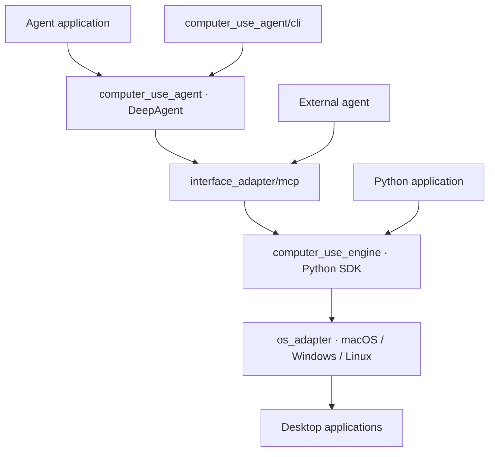

<div align="center">

# Computer Use

**openJiuwen's computer-operation engine and agent: agents that read the screen, act on controls and fill forms the way people do**

English | [简体中文](README_CN.md)

<a href="LICENSE"></a>


</div>

## Introduction

Computer Use is the desktop-operation component of the openJiuwen Agent System Service layer. It reads the accessibility tree and screenshots of desktop applications, operates controls through mouse and keyboard input, and returns operation receipts. It supports macOS, Windows and Linux.

Developers can adopt it in two ways:

**Option 1: integrate the computer_use engine.** Connect an agent through MCP or call the Python SDK directly. The MCP tool `computer_use(title, code)` runs Python against the `Computer → App → Element` interface, with variables retained across calls. Agents use accessibility trees and screenshots to locate controls and verify operation results.

**Option 2: integrate the Computer Use DeepAgent.** Use the agent assembled on openJiuwen DeepAgent through its standard `invoke()`, `stream()` and `Runner` interfaces. Applications pass natural-language tasks to the agent, which observes the desktop, performs operations and checks their results.

## Quick Start

### Connect your existing agent with one prompt

Send the appropriate prompt to a coding agent that can edit your project and run commands:

**Integrate DeepAgent:**

```text
Read https://gitcode.com/openJiuwen/computer-use/blob/main/docs/deepagent.en.md, follow its instructions to build and install Computer Use from source, integrate Computer Use DeepAgent into this project, and verify the integration.
```

**Connect over MCP:**

```text
Read https://gitcode.com/openJiuwen/computer-use/blob/main/docs/mcp.en.md, follow its instructions to build and install Computer Use from source, connect it to the agent I am using over MCP, and verify the integration.
```

## Architecture

The project has four layers: interfaces, agent assembly, the execution engine and OS adapters. Applications can integrate DeepAgent, connect an external agent over MCP, or call the SDK directly:



DeepAgent manages model calls, conversation context and the tool loop. The engine manages target identity, observations and operation routing. OS adapters prepare input receivers and dispatch operations.

## Features

- **DeepAgent integration**: standard openJiuwen invocation, streaming and Runner integration, with computer-operation tools reusable in existing DeepAgent applications.
- **Single-tool code execution**: the model writes Python, variables persist across calls, one call can complete a multi-step workflow.
- **Accessibility-tree first**: elements are numbered by decimal refs; `element(path)` queries, paged text reads and menu reads are supported.
- **Verifiable receipts**: dispatch and post-action observation are reported separately. Observations show diffs by default. Request screenshots explicitly.
- **Background-first input**: App methods accept an optional `window=` scope. On macOS, direct Computer methods send global input.
- **Cross-platform native drivers**: one each for macOS, Windows and Linux behind the same protocol.
- **Observable**: every execution is journaled as JSONL under `~/.computer-use/logs`, including code, observations and receipts.

## Project Structure

The four layers and supporting files are organized as follows:

```
computer-use/
├── interface_adapter/       # access layer: MCP integration
│   └── mcp/                 # stdio MCP host and persistent Python execution
├── computer_use_agent/      # agent assembly: DeepAgent, context and tool integration
│   └── cli/                 # direct conversation and configuration
├── computer_use_engine/     # engine: public SDK, observation and operation pipelines
├── os_adapter/              # OS adaptation: native platform backends and resources
│   ├── macos/
│   ├── windows/
│   └── linux/
├── docs/                    # build, installation and integration guides
├── scripts/                 # native build, permissions and resource generation
├── tests/                   # unit tests
├── pyproject.toml           # package metadata, dependencies and CLI entry points
├── LICENSE                  # Apache License 2.0
└── OPEN_SOURCE_SOFTWARE_NOTICE.md
```

## Documentation

- [MCP build, installation and integration](docs/mcp.en.md)
- [DeepAgent build, installation and integration](docs/deepagent.en.md)
- [Development packaging](PACKAGING.md)

- [DeepAgent integration](computer_use_agent/agent.py): agent construction, standard invocation and conversation lifecycle.
- [DeepAgent tools](computer_use_agent/toolkit.py): tools for existing openJiuwen applications.
- [SDK API reference](computer_use_engine/__init__.pyi): public interfaces and parameter types for `Computer`, `App` and `Element`.
- [MCP server](interface_adapter/mcp/server.py): tool schemas, execution instructions and global-input authorization.
- [Native setup commands](scripts/native.py): platform builds, permission checks and Linux session setup.
- [Direct conversation](computer_use_agent/cli/main.py): CLI options and interactive commands.

## Contributing

Issues and pull requests are welcome. Before submitting, please make sure that:

1. native driver changes come with instructions that build cleanly on a local machine;
2. engine-layer changes introduce no dependency on any agent framework;
3. new behavior is covered by unit tests or a reproducible probe script.

## License

This project is licensed under Apache License 2.0.

This product serves solely as a workflow orchestration tool and does not embed any AI model capabilities. When users integrate AI models for specific business scenarios, they shall bear full responsibility for compliance obligations under the EU AI Act and other relevant regulatory frameworks.
