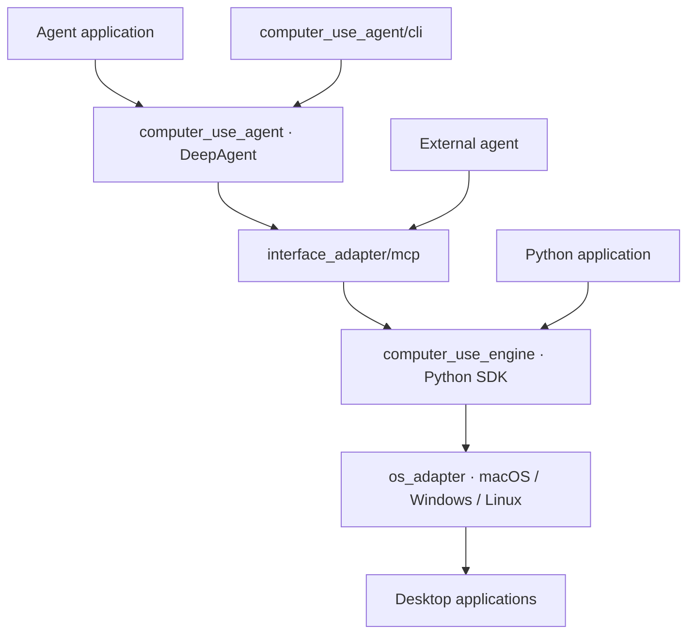

<div align="center">

# Computer Use

**openJiuwen's computer-operation engine and agent: agents that read the screen, act on controls and fill forms the way people do**

English | [简体中文](README_CN.md)

<a href="LICENSE"></a>


</div>

## Introduction

Computer Use is the desktop-operation component of the openJiuwen Agent System Service layer. It reads the accessibility tree and screenshots of desktop applications, operates controls through mouse and keyboard input, and returns operation receipts. It supports macOS, Windows and Linux.

Developers can adopt it in two ways:

**Option 1: integrate the computer_use engine.** Connect an agent through MCP or call the Python SDK directly. The MCP tool `computer_use(title, code)` runs Python against the `Computer → App / Window → Element` interface, with variables retained across calls. Agents use accessibility trees and screenshots to locate controls and verify operation results.

**Option 2: integrate the Computer Use DeepAgent.** Use the agent assembled on openJiuwen DeepAgent through its standard `invoke()`, `stream()` and `Runner` interfaces. Applications pass natural-language tasks to the agent, which observes the desktop, performs operations and checks their results.

## Quick Start

### Connect your existing agent with one prompt

Send the appropriate prompt to a coding agent that can edit your project and run commands:

**Integrate DeepAgent:**

```text
Read the README at https://gitcode.com/openJiuwen/computer-use and integrate Computer Use DeepAgent into this project, install the agent dependencies and prepare the local backend as documented, reuse the project's model configuration with create_agent and the standard invoke/stream interfaces (or add ComputerUseToolkit to an existing openJiuwen DeepAgent), and verify the integration with the task "List the running applications".
```

**Connect over MCP:**

```text
Read the README at https://gitcode.com/openJiuwen/computer-use, install and build Computer Use on this computer, add computer-use-mcp to your current MCP tool configuration as documented, check desktop permissions, and use the computer_use tool to list running applications to verify the connection.
```

### Install and prepare the host

Install Python 3.12 or later and `uv`, then clone the repository and install its dependencies:

```bash
git clone https://gitcode.com/openJiuwen/computer-use.git
cd computer-use
uv sync
```

Prepare the native dependencies on the computer whose desktop you will operate:

| Platform | Requirements |
| --- | --- |
| macOS | macOS 14 or later, an Xcode toolchain with Swift 6, Accessibility and Screen Recording permissions. |
| Windows | Windows x64 with .NET Framework 4.8 and its C# compiler; window capture requires Windows 10 1903 or later. |
| Linux | A graphical desktop session with AT-SPI and PyGObject. Use X11 for screenshots and mouse input. |

On Debian or Ubuntu, install the Linux system dependencies first:

```bash
sudo apt install python3-gi python3-venv gir1.2-atspi-2.0 libx11-6 libxkbcommon0
```

Build or prepare the native backend, then check desktop access:

```bash
uv run computer-use-build
uv run computer-use-permissions
```

On macOS, use `uv run computer-use-permissions --request` to request missing permissions. Approve them in **System Settings → Privacy & Security**, then run the check again. Run the commands from the same terminal or host connection that will launch MCP.

### Option 1: integrate the engine

#### MCP

```bash
uv run computer-use-mcp --desktop exclusive
```

The server uses stdio. For a client that accepts an `mcpServers` configuration, use:

```json
{
  "mcpServers": {
    "computer-use": {
      "command": "uv",
      "args": [
        "--directory", "/absolute/path/to/computer-use",
        "run", "computer-use-mcp", "--desktop", "exclusive"
      ]
    }
  }
}
```

Replace the checkout path with its absolute path on the target computer. `exclusive` is the desktop authorization and the default value of `COMPUTER_USE_DESKTOP`. Operations prefer element or application-directed input and acquire the foreground or use global input only when required by the selected route.

Inside the `computer_use` tool, `computer`, `print()` and `print_image()` are available. Start by discovering application references:

```python
print(await computer.list_apps())
```

Select an application with `computer.app(id)`, observe it with `await app.read(view="both")`, and resolve a control with `await app.element(name_or_path)` before operating it.

#### Python SDK

Save this example as `list_apps.py` and run it with `uv run python list_apps.py`:

```python
import asyncio

from computer_use import Computer


async def main():
    computer = Computer()
    for app in await computer.list_apps():
        print(app.id, app.display_name, app.is_running)


asyncio.run(main())
```

### Option 2: integrate DeepAgent

Use Python 3.12 or 3.13 and install the agent dependencies:

```bash
uv sync --extra agent
```

Configure a model that supports tool calls and image input using openJiuwen's `ModelClientConfig` and `ModelRequestConfig`. The example reads the provider, endpoint, credentials and model name from `MODEL_PROVIDER`, `API_BASE`, `API_KEY` and `MODEL_NAME`.

`ComputerUseAgent` inherits the standard DeepAgent `invoke()` and `stream()` interfaces and works with `Runner`. Pass a native openJiuwen `Model` and retain `conversation_id` for follow-up messages:

```python
import asyncio
import os

from openjiuwen.core.foundation.llm import Model, ModelClientConfig, ModelRequestConfig

from computer_use_agent import create_agent


async def main():
    model = Model(
        model_client_config=ModelClientConfig(
            client_provider=os.getenv("MODEL_PROVIDER", "OpenAI"),
            api_base=os.environ["API_BASE"],
            api_key=os.environ["API_KEY"],
        ),
        model_config=ModelRequestConfig(model=os.environ["MODEL_NAME"]),
    )
    async with create_agent(model) as agent:
        conversation_id = "desktop-conversation"
        print(await agent.invoke({"query": "List the running applications", "conversation_id": conversation_id}))
        async for chunk in agent.stream({"query": "Inspect the calculator window", "conversation_id": conversation_id}):
            print(chunk)


asyncio.run(main())
```

The agent uses the same background-first execution pipeline with `exclusive` desktop authorization. Configure `AgentConfig.mcp` with `McpConfig` to connect to another MCP host. The async context manager closes the computer-operation session when the conversation ends.

Existing openJiuwen DeepAgent applications can also add the standard tools provided by `ComputerUseToolkit`:

```python
from openjiuwen.harness import create_deep_agent

from computer_use_agent import ComputerUseToolkit


async def run(model):
    async with ComputerUseToolkit() as desktop:
        agent = create_deep_agent(
            model,
            tools=desktop.tools,
            system_prompt=desktop.system_prompt,
            parallel_tool_calls=False,
            enable_tool_resilience_rail=False,
            enable_sys_operation=False,
            enable_read_image_multimodal=True,
        )
        return await agent.invoke({"query": "List the running applications"})
```

#### Run directly with the CLI

The same agent can also run from the CLI. First run `uv run --extra agent computer-use-agent --init-config` and fill in `model`, `provider`, `api_base` and `api_key` in `~/.computer-use/agent/config.json`. Start a conversation or pass a task to execute once:

```bash
uv run --extra agent computer-use-agent
uv run --extra agent computer-use-agent "Open the meeting scheduling form and stop before submitting"
```

Run `uv run --extra agent computer-use-agent --help` for CLI options.

## Architecture

The project has four layers: interfaces, agent assembly, the execution engine and OS adapters. Applications can integrate DeepAgent, connect an external agent over MCP, or call the SDK directly:



DeepAgent manages model calls, conversation context and the tool loop. The engine manages the `Computer → App / Window → Element` interfaces, target identity, observations and operation routing. OS adapters resolve native objects, prepare the input receiver and dispatch operations. Agents read the UI again to confirm task results after receiving `dispatched` or `verified` receipts.

## Features

- **DeepAgent integration**: standard openJiuwen invocation, streaming and Runner integration, with computer-operation tools reusable in existing DeepAgent applications.
- **Single-tool code execution**: the model writes Python, variables persist across calls, one call can complete a multi-step workflow.
- **Accessibility-tree first**: elements are numbered by decimal refs; `element(path)` queries, paged text reads and menu reads are supported.
- **Verifiable receipts**: every action returns `dispatched` / `verified`; failures are structured as `code / effect / next`.
- **Background-first input**: prefer element and application-directed operations; acquire foreground focus or the global pointer only when the operation requires it.
- **Cross-platform native drivers**: one each for macOS, Windows and Linux behind the same protocol.
- **Observable**: every execution is journaled as JSONL under `~/.computer-use/logs`, including code, observations and receipts.

## Project Structure

The four layers and supporting files are organized as follows:

```
computer-use/
├── interface_adapter/       # access layer: MCP integration
│   └── mcp/                 # stdio MCP host and persistent Python execution
├── computer_use_agent/      # agent assembly: DeepAgent, context and tool integration
│   └── cli/                 # direct conversation and configuration
├── computer_use_engine/     # engine: public SDK, observation and operation pipelines
├── os_adapter/              # OS adaptation: native platform backends and resources
│   ├── macos/
│   ├── windows/
│   └── linux/
├── scripts/                 # native build, permissions and resource generation
├── tests/                   # unit tests
├── pyproject.toml           # package metadata, dependencies and CLI entry points
├── LICENSE                  # Apache License 2.0
└── OPEN_SOURCE_SOFTWARE_NOTICE.md
```

## Documentation

- [DeepAgent integration](computer_use_agent/agent.py): agent construction, standard invocation and conversation lifecycle.
- [DeepAgent tools](computer_use_agent/toolkit.py): tools for existing openJiuwen applications.
- [SDK API reference](computer_use_engine/__init__.pyi): public interfaces and parameter types for `Computer`, `App`, `Window` and `Element`.
- [MCP server](interface_adapter/mcp/server.py): tool schemas, execution instructions and desktop-mode arguments.
- [Native setup commands](scripts/native.py): platform builds, permission checks and Linux session setup.
- [Direct conversation](computer_use_agent/cli/main.py): CLI options and interactive commands.

## Contributing

Issues and pull requests are welcome. Before submitting, please make sure that:

1. native driver changes come with instructions that build cleanly on a local machine;
2. engine-layer changes introduce no dependency on any agent framework;
3. new behavior is covered by unit tests or a reproducible probe script.

## License

This project is licensed under Apache License 2.0.

This product serves solely as a workflow orchestration tool and does not embed any AI model capabilities. When users integrate AI models for specific business scenarios, they shall bear full responsibility for compliance obligations under the EU AI Act and other relevant regulatory frameworks.
