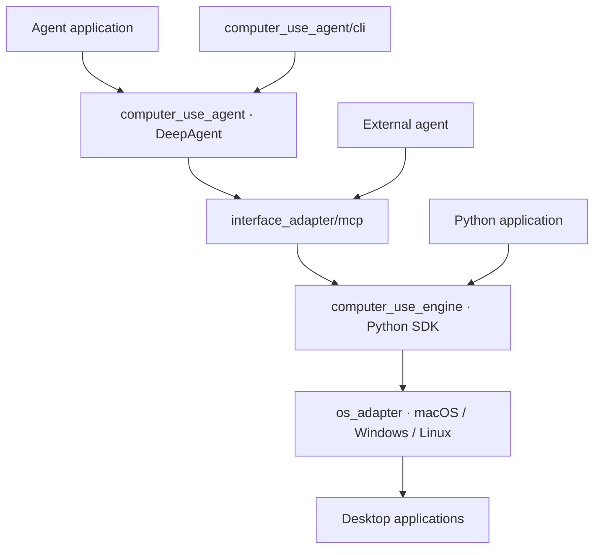

<div align="center">

# Computer Use

**openJiuwen's computer-operation engine and agent: agents that read the screen, act on controls and fill forms the way people do**

English | [简体中文](README_CN.md)

<a href="LICENSE"></a>


</div>

## Introduction

Computer Use is the desktop-operation component of the openJiuwen Agent System Service layer. It reads the accessibility tree and screenshots of desktop applications, operates controls through mouse and keyboard input, and returns operation receipts. It supports macOS, Windows and Linux.

Developers can adopt it in two ways:

**Option 1: integrate the computer_use engine.** Connect an agent through MCP or call the Python SDK directly. The MCP tool `computer_use(title, code)` runs Python against the `Computer → App / Window → Element` interface, with variables retained across calls. Agents use accessibility trees and screenshots to locate controls and verify operation results.

**Option 2: integrate the Computer Use DeepAgent.** Use the agent assembled on openJiuwen DeepAgent through its standard `invoke()`, `stream()` and `Runner` interfaces. Applications pass natural-language tasks to the agent, which observes the desktop, performs operations and checks their results.

## Quick Start

### Connect your existing agent with one prompt

Send the appropriate prompt to a coding agent that can edit your project and run commands:

**Integrate DeepAgent:**

```text
Read the README at https://gitcode.com/openJiuwen/computer-use and integrate Computer Use DeepAgent into this project, install the agent dependencies and prepare the local backend as documented, reuse the project's model configuration with create_agent and the standard invoke/stream interfaces (or add ComputerUseToolkit to an existing openJiuwen DeepAgent), and verify the integration with the task "List the running applications".
```

**Connect over MCP:**

```text
Read the README at https://gitcode.com/openJiuwen/computer-use, install and build Computer Use on this computer, add computer-use-mcp to your current MCP tool configuration as documented, check desktop permissions, and use the computer_use tool to list running applications to verify the connection.
```

### Install and prepare the host

Install Python 3.12 or later and `uv`, then clone the repository and install its dependencies:

```bash
git clone https://gitcode.com/openJiuwen/computer-use.git
cd computer-use
uv sync --no-dev
```

This installs the standalone SDK without MCP or model dependencies. MCP and the
reference Agent have separate `mcp` and `agent` extras; the Agent extra includes
its MCP connection dependency. For development, plain `uv sync` also installs
the test, lint and build tools, including MCP for integration tests.

To install a built wheel in another virtual environment, use
`uv pip install /absolute/path/to/computer_use_toolkit-0.0.1-py3-none-any.whl`.
The wheel includes native source resources; run `computer-use-build` and
`computer-use-permissions` in that environment on the target computer before
using the SDK. Native builds write to a versioned user-owned runtime directory.

Prepare the native dependencies on the computer whose desktop you will operate:

| Platform | Requirements |
| --- | --- |
| macOS | macOS 14 or later, an Xcode toolchain with Swift 6, Accessibility and Screen Recording permissions. |
| Windows | Windows x64 with .NET Framework 4.8 and its C# compiler; window capture requires Windows 10 1903 or later. |
| Linux | A graphical desktop session with AT-SPI and PyGObject. Use X11 for screenshots and mouse input. |

On Debian or Ubuntu, install the Linux system dependencies first:

```bash
sudo apt install python3-gi python3-venv gir1.2-atspi-2.0 libx11-6 libxkbcommon0
```

Build or prepare the native backend, then check desktop access:

```bash
uv run --no-dev computer-use-build
uv run --no-dev computer-use-permissions
```

On macOS, use `uv run --no-dev computer-use-permissions --request` to request missing permissions. Approve them in **System Settings → Privacy & Security**, then run the check again. Run the commands from the same terminal or host connection that will launch the SDK or its MCP adapter.

### Option 1: integrate the engine

#### MCP

```bash
uv run --no-dev --extra mcp computer-use-mcp
```

For a wheel installation, install the same wheel with its `mcp` extra, for example
`uv pip install '/absolute/path/to/computer_use_toolkit-0.0.1-py3-none-any.whl[mcp]'`,
then run `computer-use-mcp` from that environment.

The server uses stdio. For a client that accepts an `mcpServers` configuration, use:

```json
{
  "mcpServers": {
    "computer-use": {
      "command": "uv",
      "args": [
        "--directory", "/absolute/path/to/computer-use",
        "run", "--no-dev", "--extra", "mcp", "computer-use-mcp"
      ]
    }
  }
}
```

Replace the checkout path with its absolute path on the target computer. On macOS, App/Window/Element operations never inject global mouse or keyboard input; agents explicitly select direct Computer input methods when needed. Windows/Linux retain their existing global-input capabilities. Each action records the selected route's declared need for global input separately from its actual effects. To explicitly restrict a session to non-global input, pass `--no-allow-global-input`. System permissions must still be available on the target computer.

Inside the `computer_use` tool, `computer`, `print()` and `print_image()` are available. Start by discovering application references:

```python
print(computer.list_apps())
```

The SDK is synchronous: each operation returns its result or raises before the next statement runs.
Select an application with `computer.app(id)`, observe it with `app.read(view="both")`, and resolve a control with
`app.element(name_or_path)`. A confirmed target can be used directly, for example `app.element("Save").click()`.

Within one tool call, every action receipt is retained while superseded automatic observations of the same scope are
coalesced into the final state. Distinct popups and explicitly printed or full observations are preserved.
Window coordinate actions retain visual feedback and collect available accessibility information independently.
MCP automatically presents initially collected content and then changes (diffs) by default, including observations after
writes and consecutive operations in one call. Each window reports AX/image acquisition and specific gaps separately;
full/diff/unchanged identifies the text presentation mode. Use `app.read(full=True)` or `window.read(full=True)` to restore full
context; no private client history protocol is required. The SDK's `state.text` remains complete for the captured scope;
diff presentation does not change element bindings or screenshot coordinates.
In MCP, printing an observation, its `.text`, or a direct text slice reuses automatic presentation instead of adding
another full view. SDK string values, slices, and file output remain unchanged. Use a subtree or `read_text` to bound
the observation scope.

Reads do not activate or raise windows to refresh pixels by default. On macOS,
`app.read(view="both", allow_foreground=True)` explicitly allows preparation of the confirmed original window;
the same option is available on `Window.read()`.
This may change focus and stacking, but sends no global mouse/keyboard input and does not switch back afterward.
The observation's `preparation` record and text retain the requests made; images retain their capture provenance.
An unresolved observation target still returns window choices instead of using this permission to guess a target.
Other platforms do not yet implement this preparation capability.

Writes include a bounded related observation independently of their execution result.
Inspect `result.observation`, `result.observation_status`, and `result.observation_error`.
`result.target`, `result.intent`, and `result.status` retain the operation's target, intent and dispatch/local verification.
A `ComputerUseError` for an expired target,
temporarily incomplete target evidence, a modal blocker, or `effect="partial"` / `"possible"` also retains
these fields when the original session can still be observed. Use the attached current observation to
decide the next action. The original error and effect remain unchanged; the SDK does not replay uncertain input.

MCP and the reference Agent share one static tool contract. Results present UI content, object identities,
execution progress and specific gaps. Each image retains its ID, source, dimensions and coordinate target through
DeepAgent conversion. Advisory `next` fields have been removed from `ComputerUseError` and `ObservationError`;
`TextPage.next` remains the pagination cursor.

#### Python SDK

Save this example as `list_apps.py` and run it with `uv run --no-dev python list_apps.py`:

```python
from computer_use import Computer


with Computer() as computer:  # Qualified low-impact routes remain preferred.
    for app in computer.list_apps():
        print(app.id, app.display_name, app.is_running)
```

`Computer.close()` releases the session's driver resources; the context manager calls it on exit.
The public SDK uses ordinary synchronous calls, including `Observation.read_details()`.
When embedding it in an asyncio or GUI application, run the blocking computer-operation code in a worker thread
so the host remains responsive. Internal driver communication, progress and cleanup continue asynchronously.

`allow_global_input` is a strict boolean session option, defaulting to `True`;
it does not grant macOS system permissions. On macOS, App/Window/Element methods
use AX or directed events throughout preparation, input and recovery. They may
activate/focus their target, but never inject global mouse or keyboard input.
Direct Computer input methods explicitly select global delivery for that call.
Windows/Linux retain the existing ability to use global input for object operations;
the same fixed boundary is future platform work.
`Computer(allow_global_input=False)` rejects explicit global input with `permission_required`.
A macOS object operation lacking a qualified non-global route reports `input_unavailable`.

On macOS, direct Computer input sends system-wide events. The current desktop and
keyboard focus determine the recipient. Bare coordinates are global screen points,
including negative secondary-display coordinates; no prior observation is required.
Computer input does not activate an application or restore the previous foreground.

```python
computer.click(at=(640, 360))
computer.type_text("global input")
computer.press_key("Return")
```

Use an explicit image point or an existing element to resolve a pointer location:

```python
field = app.element("Input")
field.type_text("scoped", replace=True)
computer.click(target=field)  # Resolve a screen point, then send a global click.
computer.press_key("super+a") # Explicit selection in the current system recipient.
computer.type_text("global")
computer.paste("multiple\nlines")

p = app.point((120, 80))  # Pixels in the previously delivered App image; no read or input.
app.click(at=p)          # Directed on macOS.
computer.click(target=p) # Global input at the same destination.
```

`Target` retains its element or image-point source independently of later reads.
For Computer pointer input it resolves a screen point once, without handling occlusion,
scrolling into view, or focus. Dispatch does not subsequently lock the original object.
Global drag endpoints may come from different windows or images. Object methods keep
their original target and image-binding semantics.
Global keyboard methods do not accept `target=` or an implicit `replace=True`;
click and select explicitly before typing when needed. Global input returns its dispatch
receipt; read explicitly for observation. A failed read does not block subsequent global
input. Cursor position and foreground remain as the operation leaves them. See `result.impact`.
These direct global and locator semantics are implemented first on macOS; Windows/Linux
desktop input retains its existing screenshot context pending platform migration.
`Computer.paste(text)` is currently implemented on macOS; use the existing object
paste methods on Windows/Linux until their global paste primitive is implemented.

`App` identifies an application scope; `list_apps()` lists applications. App and
desktop observations publish window references. Use `computer.window(ref)` to
select a specific window directly, or `app.window(ref)` to select the same window
while also checking application ownership. Neither selection activates a window.
Window references are shared across desktop, App and post-action observations;
titles and positions are descriptions, not target identities.

A `Window` remains bound to that window. Closing it invalidates its old handles
and captures; the App can still discover other windows. Element operations keep
their original control binding, and coordinates use the image actually delivered
for the operation. App-level keyboard input uses the latest explicitly delivered
input context, not whichever window happens to have focus when the call executes.
Handles for the same App share the actually delivered lookup scope, keyboard
context and image; undisclosed samples do not replace them. Fixed Windows retain
their own observations and images, including a delivered, confirmed modal input context.
The SDK handles target preparation; a genuinely ambiguous context returns window
choices. Each `choices` entry is a `WindowInfo` with an `id` accepted by
`computer.window(id)` and a descriptive `title`. Post-action observation may show
a newly discovered window without rebinding existing Window, Element or screenshot targets.

On macOS, live element references survive unrelated layout-wrapper changes, partial observations,
and cache pressure from other references. The SDK refreshes necessary operation facts.
A destroyed element, closed/reopened window, or actual document ownership change still rejects the
old reference and includes the related observation when available. `app.element(ref)` and
`window.element(ref)` can retrieve a reference already published by that application; constructing
the handle does not claim its target is alive or authorize access. Actual reads and writes check
the original window scope and lifetime, so failed writes can return current observation in the same call.
Action identities are independent
of bounded historical text caches; minimal reference metadata remains until confirmed retirement or
session end. This native stability improvement and its real SDK/MCP validation cover macOS;
the corresponding Windows/Linux native changes and validation are follow-up work.

The standalone SDK returns source screenshots and their original pixel coordinates.
When MCP resizes an image, public observation text and PNG share the delivered coordinate
space, including text split into lines or assembled into strings. Image point locators map
back using each axis's actual encoded size. Arbitrary PIL crops do not acquire an input
mapping. On macOS, bare Computer coordinates always mean screen points; use `point()`
to explicitly convert image coordinates.

Execution and observation have separate results. `status` reports dispatch or
available verification, not completion of the application's business operation.
`observation_status` is `available`, `partial`, `unavailable`, or `not_requested`.
`window_lifecycle` is `observed`, `closed`, `unknown`, or `not_applicable`; absence
of pixels alone does not prove closure. When the original window is gone, related
observations can still provide current window choices. Existing Window and Element
handles do not switch to those alternatives. `observation_error.session_usable` tells the caller whether
the original session remains usable; it is not permission to replay uncertain input.

`ActionResult.impact` and `ComputerUseError.impact` expose read-only execution
evidence. `global_input_allowed` records the session grant. Each `attempts` item
separates `declared_global_input` and `preparation_potential` from dispatch,
cleanup, and `actual` native evidence. `actual.effects` groups calls by stage,
device, transport, mechanism, and invocation state; it is not a per-keystroke log
or proof that the app consumed the input. `foreground_changed` and
`clipboard_restoration` retain their known or unknown outcomes.
Missing `impact`/`actual` or partial `actual.coverage` means evidence is unavailable
or incomplete, not that nothing happened. Even complete coverage describes only
that native execution step; it excludes separate reads, later session cleanup,
and the application's asynchronous consequences.

Each SDK operation targets roughly 1000ms without a default total deadline. Native requests
retain their own timeouts. An explicitly supplied operation deadline is shared across nested
lookup, preparation, requests and observation; recovery does not renew it.
Returned native outcomes are retained before subsequent observation or
cleanup. `sdk_operation_end` diagnostics record elapsed time, target overruns, deadline overruns, observation
completeness and gaps. MCP metadata separately records the whole tool call, including
startup, multiple SDK operations and final delivery.

On macOS, post-action observation can use application change notifications to collect
new windows or missing components within the original budget. Image-only observation
does not initialize accessibility for this feature. Fixed windows retain their own
delivered image mappings; hiding and reappearing are distinct from destruction.
These notification, native input and capture improvements currently target macOS;
the corresponding Windows/Linux implementations and desktop validation are follow-up work.

### Option 2: integrate DeepAgent

Use Python 3.12 or 3.13 and install the agent dependencies:

```bash
uv sync --no-dev --extra agent
```

For a wheel installation, select the `agent` extra instead; it includes MCP.

Configure a model that supports tool calls and image input using openJiuwen's `ModelClientConfig` and `ModelRequestConfig`. The example reads the provider, endpoint, credentials and model name from `MODEL_PROVIDER`, `API_BASE`, `API_KEY` and `MODEL_NAME`.

`ComputerUseAgent` inherits the standard DeepAgent `invoke()` and `stream()` interfaces and works with `Runner`. Pass a native openJiuwen `Model` and retain `conversation_id` for follow-up messages:

```python
import asyncio
import os

from openjiuwen.core.foundation.llm import Model, ModelClientConfig, ModelRequestConfig

from computer_use_agent import create_agent


async def main():
    model = Model(
        model_client_config=ModelClientConfig(
            client_provider=os.getenv("MODEL_PROVIDER", "OpenAI"),
            api_base=os.environ["API_BASE"],
            api_key=os.environ["API_KEY"],
        ),
        model_config=ModelRequestConfig(model=os.environ["MODEL_NAME"]),
    )
    async with create_agent(model) as agent:
        conversation_id = "desktop-conversation"
        print(await agent.invoke({"query": "List the running applications", "conversation_id": conversation_id}))
        async for chunk in agent.stream({"query": "Inspect the calculator window", "conversation_id": conversation_id}):
            print(chunk)


asyncio.run(main())
```

The agent uses the same low-impact-first execution pipeline. `AgentConfig.allow_global_input` defaults to `True` for its local MCP session; an explicit `False` is forwarded as a restriction. Configure `AgentConfig.mcp` with `McpConfig` to connect to another MCP host. The async context manager closes the computer-operation session when the conversation ends.

Existing openJiuwen DeepAgent applications can also add the standard tools provided by `ComputerUseToolkit`:

```python
from openjiuwen.harness import create_deep_agent

from computer_use_agent import ComputerUseToolkit


async def run(model):
    async with ComputerUseToolkit() as desktop:
        agent = create_deep_agent(
            model,
            tools=desktop.tools,
            system_prompt=desktop.system_prompt,
            parallel_tool_calls=False,
            enable_tool_resilience_rail=False,
            enable_sys_operation=False,
            enable_read_image_multimodal=True,
        )
        return await agent.invoke({"query": "List the running applications"})
```

#### Run directly with the CLI

The same agent can also run from the CLI. First run `uv run --extra agent computer-use-agent --init-config` and fill in `model`, `provider`, `api_base` and `api_key` in `~/.computer-use/agent/config.json`. Start a conversation or pass a task to execute once:

```bash
uv run --extra agent computer-use-agent
uv run --extra agent computer-use-agent "Open the meeting scheduling form and stop before submitting"
```

Run `uv run --extra agent computer-use-agent --help` for CLI options.

## Architecture

The project has four layers: interfaces, agent assembly, the execution engine and OS adapters. Applications can integrate DeepAgent, connect an external agent over MCP, or call the SDK directly:



DeepAgent manages model calls, conversation context and the tool loop. The engine manages the `Computer → App / Window → Element` interfaces, target identity, observations and operation routing. OS adapters resolve native objects, prepare the input receiver and dispatch operations. A completed action returns its `dispatched` or `verified` receipt and a bounded related observation. Agents use that observation, and further reads when needed, to judge task results. Failure of the related read does not erase or replay the action.

## Features

On macOS, background input preparation conditionally returns foreground control changed temporarily
by the SDK while retaining the target's internal input context. This is not an unconditional restore
after every operation: explicit activation and subsequent user choices are preserved. Workspace
switches and session shutdown do not send an extra deactivation notification that would undo an open
menu; paired input and observers are still released. Equivalent foreground restoration and menu
continuity improvements for Windows/Linux remain future work. Actual-impact receipts distinguish
foreground changes, restoration outcomes and global input; they do not certify application business results.

- **DeepAgent integration**: standard openJiuwen invocation, streaming and Runner integration, with computer-operation tools reusable in existing DeepAgent applications.
- **Single-tool code execution**: the model writes Python, variables persist across calls, one call can complete a multi-step workflow.
- **Accessibility-tree first**: elements are numbered by decimal refs; `element(path)` queries, paged text reads and menu reads are supported.
- **Verifiable receipts**: actions retain `target / intent / status` independently of `observation_status` and `observation_error`. Input failures expose `code / effect / target / detail / impact`. `unsupported_operation` means the required capability or operation is unavailable; `permission_required` identifies a missing input grant.
- **Background-first input**: prefer element and application-directed operations; on macOS, use direct Computer input methods to explicitly select global mouse or keyboard input.
- **Cross-platform native drivers**: one each for macOS, Windows and Linux behind the same protocol.
- **Observable**: every execution is journaled as JSONL under `~/.computer-use/logs`, including code, observations and receipts.

## Project Structure

The four layers and supporting files are organized as follows:

```
computer-use/
├── interface_adapter/       # access layer: MCP integration
│   └── mcp/                 # stdio MCP host and persistent Python execution
├── computer_use_agent/      # agent assembly: DeepAgent, context and tool integration
│   └── cli/                 # direct conversation and configuration
├── computer_use_engine/     # engine: public SDK, observation and operation pipelines
├── os_adapter/              # OS adaptation: native platform backends and resources
│   ├── macos/
│   ├── windows/
│   └── linux/
├── scripts/                 # native build, permissions and resource generation
├── tests/                   # unit tests
├── pyproject.toml           # package metadata, dependencies and CLI entry points
├── LICENSE                  # Apache License 2.0
└── OPEN_SOURCE_SOFTWARE_NOTICE.md
```

## Documentation

- [DeepAgent integration](computer_use_agent/agent.py): agent construction, standard invocation and conversation lifecycle.
- [DeepAgent tools](computer_use_agent/toolkit.py): tools for existing openJiuwen applications.
- [SDK API reference](computer_use_engine/__init__.pyi): public interfaces and parameter types for `Computer`, `App`, `Window` and `Element`.
- [MCP server](interface_adapter/mcp/server.py): tool schemas, execution instructions and global-input authorization.
- [Native setup commands](scripts/native.py): platform builds, permission checks and Linux session setup.
- [Direct conversation](computer_use_agent/cli/main.py): CLI options and interactive commands.

## Contributing

Issues and pull requests are welcome. Before submitting, please make sure that:

1. native driver changes come with instructions that build cleanly on a local machine;
2. engine-layer changes introduce no dependency on any agent framework;
3. new behavior is covered by unit tests or a reproducible probe script.

## License

This project is licensed under Apache License 2.0.

This product serves solely as a workflow orchestration tool and does not embed any AI model capabilities. When users integrate AI models for specific business scenarios, they shall bear full responsibility for compliance obligations under the EU AI Act and other relevant regulatory frameworks.
