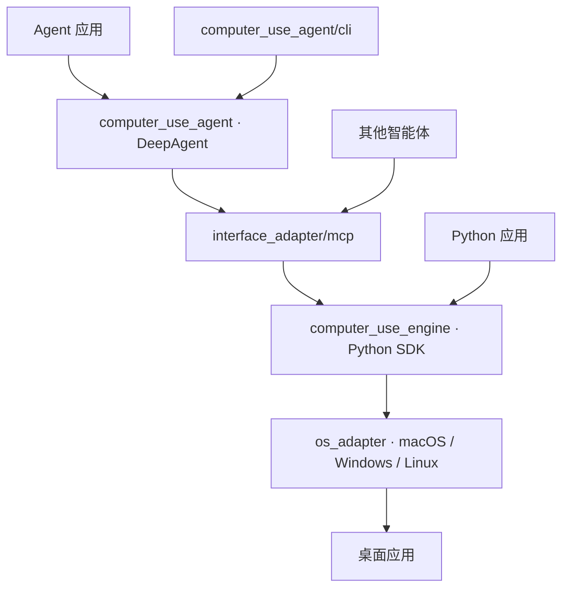

<div align="center">

# Computer Use

**openJiuwen 的计算机操作引擎与智能体：让智能体像人一样读屏幕、点控件、填表单**

[English](README.md) | 简体中文

<a href="LICENSE"></a>


</div>

## 简介

Computer Use 是 openJiuwen 智能体系统服务层（Agent System Service）中的桌面操作组件。它读取桌面应用的无障碍树与截图，通过鼠标键盘操作控件，并返回操作回执。当前支持 macOS、Windows、Linux。

开发者有两种形式可以接入使用：

**方法 1：接入 computer_use 引擎。** 通过 MCP 连接智能体，或直接调用 Python SDK。MCP 工具 `computer_use(title, code)` 提供 `Computer → App → Element` 接口，模型编写 Python 完成操作，变量跨调用保留。智能体结合无障碍树和截图定位控件，并读取界面验证操作结果。

**方法 2：接入 Computer Use DeepAgent。** 使用基于 openJiuwen DeepAgent 组装的电脑操作智能体，通过标准 `invoke()`、`stream()` 和 `Runner` 接口集成到应用中。应用向智能体传入自然语言任务，由智能体观察桌面、执行操作并核对结果。

## 快速开始

### 一句话接入现有 Agent

将对应文案发送给能修改项目代码、执行命令的编程 Agent：

**接入 DeepAgent：**

```text
请阅读 https://gitcode.com/openJiuwen/computer-use/blob/main/docs/deepagent.md，按文档从源码构建安装 Computer Use，将 Computer Use DeepAgent 接入当前项目并验证接入。
```

**通过 MCP 接入：**

```text
请阅读 https://gitcode.com/openJiuwen/computer-use/blob/main/docs/mcp.md，按文档从源码构建安装 Computer Use，通过 MCP 接入我正在使用的 Agent 并验证接入。
```

## 架构简介

项目由接入层、Agent 组装层、引擎层和操作系统适配层组成。应用可以集成 DeepAgent，也可以通过 MCP 接入其他智能体，或直接调用 SDK：



DeepAgent 负责模型调用、对话上下文与工具循环；引擎维护 `Computer → App → Element` 接口、目标身份、观察结果及操作选路；操作系统适配器负责解析原生对象、准备输入接收者并派发操作。已完成的对象动作返回 `dispatched` 或 `verified` 回执及一次有界的相关观察。macOS 的 Computer 全局输入只返回派发回执，需要观察时显式读取。智能体据此判断任务效果，需要更多或更新证据时再读取；附带读取失败不抹掉动作回执，也不重放输入。

## 功能特性

App 方法通过可选的 `window=` 限定本次窗口范围，已取得的 Element 和图像 Target 保留自己的绑定。
macOS 将已确认的下拉列表和菜单作为宿主的附属内容交付，底层独立截图或输入接收窗口不会自动变成新的工作窗口。
新界面与菜单的相关内容随对象操作返回；关系未知的内容明确标注来源，观察补充不会扩大原窗口的输入范围。
默认观察和同源菜单优先返回 diff；首次交付来源或显式 `full=True` 返回完整内容。
每次显式读取都重新采集，即使它们位于同一个工具调用内。自动写后观察按相关范围交付文字和动作回执，图像通过显式读取获取。
macOS 可在启动 SDK 或 MCP 前设置 `COMPUTER_USE_AX_SUBTREE_PREFETCH=1`，为合格的窗口树启用批量属性预取。子节点顺序、几何和身份仍现场读取，预取缺失或不可用时沿用普通 AX 采集。
图像均以实际交付 PNG 左上角的像素为坐标，局部截图缺失不取消其他有效片段的取点能力。
macOS 的 App 普通单左键坐标点击，在精确命中已展开菜单的普通可选菜单项时，可以通过该项的 Press 动作完成选择。
不匹配时保持原定向鼠标路线；需要真实鼠标事件过程时使用 `app.click(at=p, force_pointer=True)`。
该选项不授予全局输入，Computer 全局点击和元素点击接口保持各自语义；Windows/Linux 保持已有坐标鼠标路线。

macOS 的对象输入准备会在条件允许时归还由 SDK 临时改变的前台，并保留目标内部接收状态。
它不在每次操作后统一切回旧应用，不撤销显式置前，也不覆盖用户后续切换。
需要前台存续的菜单可以保留到后续选择或取消；同一交互沿用最初借用记录，条件允许时归还到具体原窗口。
两次调用之间不自行操作桌面。显式 Computer 全局输入仅终止旧恢复权，不增加焦点准备或自动归还，也不自动移回鼠标。
工作区切换和会话结束不会通过额外失活通知撤销已打开的菜单；配对输入与监听器仍正常释放。
Windows/Linux 对应的临时前台归还与菜单连续性改进列为后续实现，不能据 macOS 验证推定已支持。
本轮原生附属内容发现、同物理窗口多 AX 来源识别也以 macOS 为实现范围；Windows/Linux 需要独立补齐与验收。
操作回执的实际影响可用于区分前台变化、归还结果和全局输入；恢复结果不代表应用业务完成。

Windows 普通读取使用窗口的当前状态。`app.read(window=ref, view="both", allow_foreground=True)` 明确允许恢复或激活该窗口，返回准备回执和实际前台状态。如果请求窗口图片而只能取得桌面图，结果会明确标注桌面范围，使用 `computer.point((x, y))` 获取该图上的点。

Windows 任务给出完整窗口标题时，使用 `computer.app(window_title=title).read()`。首次读取在可见原生窗口目录中按区分大小写的标题匹配唯一窗口。标题变化后继续使用同一 App，读取和写后观察只覆盖已绑定窗口。菜单路径与独立确认窗口的行为见 [SDK 参考](docs/mcp.md#python-sdk)。

- **DeepAgent 接入**：支持 openJiuwen 标准调用、流式输出和 Runner 接入，电脑操作工具可复用于已有 DeepAgent 应用。
- **单工具代码执行**：模型写 Python，变量跨调用保留，一次调用完成多步工作流。
- **无障碍树优先**：元素按十进制 ref 编号，支持 `element(path)` 路径查询、文本分页读取、菜单读取。
- **可核验回执**：动作的 `target / intent / status` 与 `observation_status`、`observation_error` 分别保留；输入失败提供 `code / effect / target / detail / impact`。`unsupported_operation` 表示所需能力／操作未实现，`permission_required` 表示该路线需要尚未授予的输入权限。
- **后台优先输入**：优先使用元素和应用定向操作；macOS 对象操作固定非全局，需要全局鼠标或键盘时显式调用 Computer 的直接输入方法。
- **跨平台原生驱动**：macOS、Windows、Linux 各一套，协议一致。
- **可观测**：每次执行写入 `~/.computer-use/logs` 的 JSONL 日志，含代码、观测与回执。

名称和路径定位优先复用最近已返回的语义观察，包括操作返回的写后观察；信息不足、未匹配或已知失效时，SDK 在同次调用内按原规则现场查询。
需要明确查询当前界面时使用 `app.element("保存", fresh=True)`。`fresh` 只控制名称／路径；编号与已保存的 Element 始终保留原对象绑定，不会自动改绑同名新对象。
定位复用不省略后续写入的现场判断、准备或恢复，也不保证观察之外发生的对象重建已被发现。
查看刚返回的捕获内容可使用 `result.observation.read_details(element=ref)`；显式 `app.read()`、`element.read()` 和 `element.read_text()` 仍会获取新观察，`full=True` 只控制全文展示。

## 项目结构

四层代码与配套文件的目录组织如下：

```
computer-use/
├── interface_adapter/       # 接入层：MCP 接入
│   └── mcp/                 # stdio MCP 宿主与持久化 Python 执行环境
├── computer_use_agent/      # Agent 组装层：DeepAgent、上下文与工具接入
│   └── cli/                 # 直接对话与配置
├── computer_use_engine/     # 引擎层：公共 SDK、观察与操作管线
├── os_adapter/              # 操作系统适配层：原生后端与共用资源
│   ├── macos/
│   ├── windows/
│   └── linux/
├── docs/                    # 构建、安装与接入指南
├── scripts/                 # 原生构建、权限检查与资源生成
├── tests/                   # 单元测试
├── pyproject.toml           # 包元数据、依赖与命令行入口
├── LICENSE                  # Apache License 2.0
└── OPEN_SOURCE_SOFTWARE_NOTICE.md
```

## 完整文档

- [MCP 构建、安装与接入](docs/mcp.md)
- [DeepAgent 构建、安装与接入](docs/deepagent.md)
- [开发打包说明](PACKAGING.md)
- [DeepAgent 接入](computer_use_agent/agent.py)：Agent 构建、标准调用与会话生命周期。
- [DeepAgent 工具](computer_use_agent/toolkit.py)：已有 openJiuwen 应用的工具接入。
- [SDK 接口参考](computer_use_engine/__init__.pyi)：`Computer`、`App`、`Element` 的公开接口与参数类型。
- [MCP 服务入口](interface_adapter/mcp/server.py)：工具定义、执行说明与全局输入授权参数。
- [原生环境准备命令](scripts/native.py)：各平台构建、权限检查与 Linux 会话配置。
- [直接对话](computer_use_agent/cli/main.py)：命令行选项与交互命令。

## 参与贡献

欢迎通过 Issue 与 Pull Request 参与。提交前请确保：

1. 原生驱动改动附带可在本机编译通过的说明；
2. 引擎层改动不引入对任何智能体框架的依赖；
3. 新增行为有对应的单元测试或可复现的探针脚本。

## 开源许可证

本项目基于 [Apache License 2.0](LICENSE) 开源。

本产品仅作为流程编排工具，不包含 AI 模型能力；用户在连接 AI 模型用于特定业务场景时，需自行承担欧盟 AI 法案等相关合规义务。
