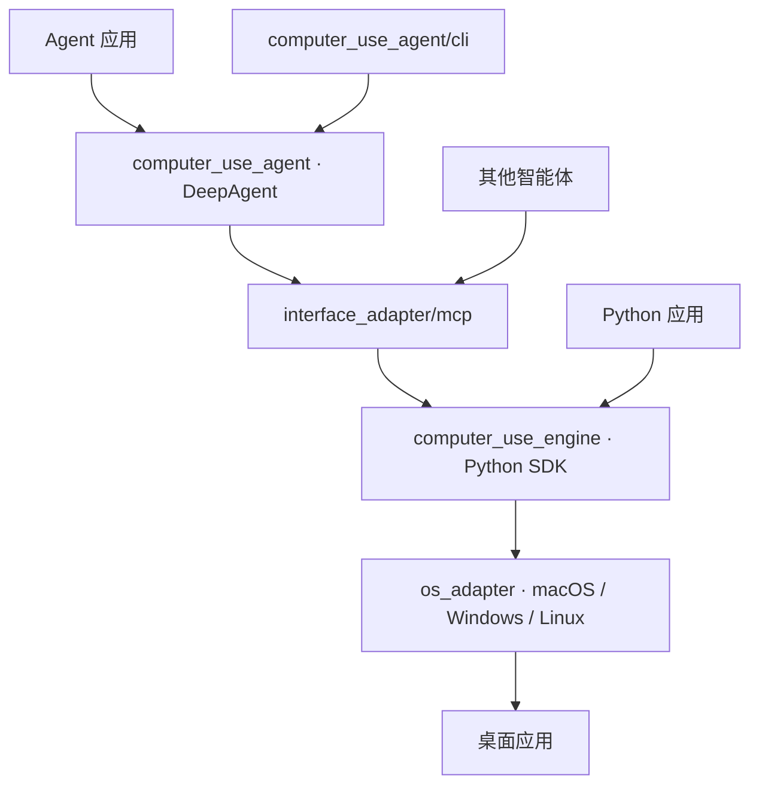

<div align="center">

# Computer Use

**openJiuwen 的计算机操作引擎与智能体：让智能体像人一样读屏幕、点控件、填表单**

[English](README.md) | 简体中文

<a href="LICENSE"></a>


</div>

## 简介

Computer Use 是 openJiuwen 智能体系统服务层（Agent System Service）中的桌面操作组件。它读取桌面应用的无障碍树与截图，通过鼠标键盘操作控件，并返回操作回执。当前支持 macOS、Windows、Linux。

开发者有两种形式可以接入使用：

**方法 1：接入 computer_use 引擎。** 通过 MCP 连接智能体，或直接调用 Python SDK。MCP 工具 `computer_use(title, code)` 提供 `Computer → App → Element` 接口，模型编写 Python 完成操作，变量跨调用保留。智能体结合无障碍树和截图定位控件，并读取界面验证操作结果。

**方法 2：接入 Computer Use DeepAgent。** 使用基于 openJiuwen DeepAgent 组装的电脑操作智能体，通过标准 `invoke()`、`stream()` 和 `Runner` 接口集成到应用中。应用向智能体传入自然语言任务，由智能体观察桌面、执行操作并核对结果。

## 快速开始

### 一句话接入现有 Agent

将对应文案发送给能修改项目代码、执行命令的编程 Agent：

**接入 DeepAgent：**

```text
请阅读 https://gitcode.com/openJiuwen/computer-use/blob/main/docs/deepagent.md，按文档从源码构建安装 Computer Use，将 Computer Use DeepAgent 接入当前项目并验证接入。
```

**通过 MCP 接入：**

```text
请阅读 https://gitcode.com/openJiuwen/computer-use/blob/main/docs/mcp.md，按文档从源码构建安装 Computer Use，通过 MCP 接入我正在使用的 Agent 并验证接入。
```

## 架构简介

项目由接入层、Agent 组装层、引擎层和操作系统适配层组成。应用可以集成 DeepAgent，也可以通过 MCP 接入其他智能体，或直接调用 SDK：



DeepAgent 负责模型调用、对话上下文与工具循环。引擎维护目标身份、观察结果及操作选路。操作系统适配器准备输入接收者并派发操作。

## 功能特性

- **DeepAgent 接入**：支持 openJiuwen 标准调用、流式输出和 Runner 接入，电脑操作工具可复用于已有 DeepAgent 应用。
- **单工具代码执行**：模型写 Python，变量跨调用保留，一次调用完成多步工作流。
- **无障碍树优先**：元素按十进制 ref 编号，支持 `element(path)` 路径查询、文本分页读取、菜单读取。
- **可核验回执**：派发结果与写后观察分别返回。观察默认展示 diff，截图通过显式读取获取。
- **后台优先输入**：App 方法可用 `window=` 指定范围。macOS 的全局输入由 Computer 的直接输入方法触发。
- **跨平台原生驱动**：macOS、Windows、Linux 各一套，协议一致。
- **可观测**：每次执行写入 `~/.computer-use/logs` 的 JSONL 日志，含代码、观测与回执。

## 项目结构

四层代码与配套文件的目录组织如下：

```
computer-use/
├── interface_adapter/       # 接入层：MCP 接入
│   └── mcp/                 # stdio MCP 宿主与持久化 Python 执行环境
├── computer_use_agent/      # Agent 组装层：DeepAgent、上下文与工具接入
│   └── cli/                 # 直接对话与配置
├── computer_use_engine/     # 引擎层：公共 SDK、观察与操作管线
├── os_adapter/              # 操作系统适配层：原生后端与共用资源
│   ├── macos/
│   ├── windows/
│   └── linux/
├── docs/                    # 构建、安装与接入指南
├── scripts/                 # 原生构建、权限检查与资源生成
├── tests/                   # 单元测试
├── pyproject.toml           # 包元数据、依赖与命令行入口
├── LICENSE                  # Apache License 2.0
└── OPEN_SOURCE_SOFTWARE_NOTICE.md
```

## 完整文档

- [MCP 构建、安装与接入](docs/mcp.md)
- [DeepAgent 构建、安装与接入](docs/deepagent.md)
- [开发打包说明](PACKAGING.md)
- [DeepAgent 接入](computer_use_agent/agent.py)：Agent 构建、标准调用与会话生命周期。
- [DeepAgent 工具](computer_use_agent/toolkit.py)：已有 openJiuwen 应用的工具接入。
- [SDK 接口参考](computer_use_engine/__init__.pyi)：`Computer`、`App`、`Element` 的公开接口与参数类型。
- [MCP 服务入口](interface_adapter/mcp/server.py)：工具定义、执行说明与全局输入授权参数。
- [原生环境准备命令](scripts/native.py)：各平台构建、权限检查与 Linux 会话配置。
- [直接对话](computer_use_agent/cli/main.py)：命令行选项与交互命令。

## 参与贡献

欢迎通过 Issue 与 Pull Request 参与。提交前请确保：

1. 原生驱动改动附带可在本机编译通过的说明；
2. 引擎层改动不引入对任何智能体框架的依赖；
3. 新增行为有对应的单元测试或可复现的探针脚本。

## 开源许可证

本项目基于 [Apache License 2.0](LICENSE) 开源。

本产品仅作为流程编排工具，不包含 AI 模型能力；用户在连接 AI 模型用于特定业务场景时，需自行承担欧盟 AI 法案等相关合规义务。
