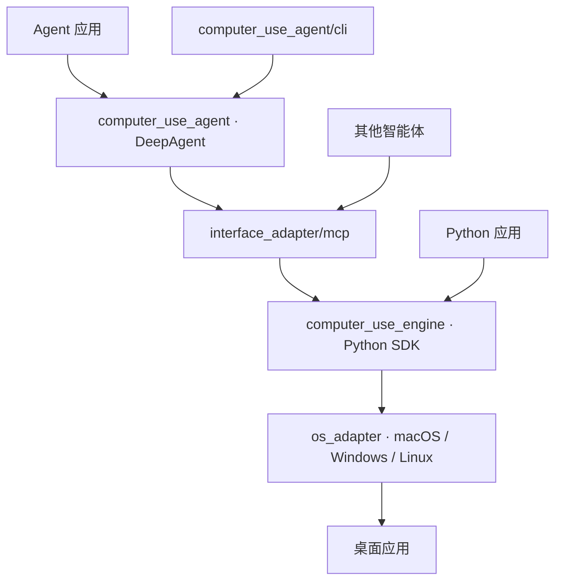

<div align="center">

# Computer Use

**openJiuwen 的计算机操作引擎与智能体：让智能体像人一样读屏幕、点控件、填表单**

[English](README.md) | 简体中文

<a href="LICENSE"></a>


</div>

## 简介

Computer Use 是 openJiuwen 智能体系统服务层（Agent System Service）中的桌面操作组件。它读取桌面应用的无障碍树与截图，通过鼠标键盘操作控件，并返回操作回执。当前支持 macOS、Windows、Linux。

开发者有两种形式可以接入使用：

**方法 1：接入 computer_use 引擎。** 通过 MCP 连接智能体，或直接调用 Python SDK。MCP 工具 `computer_use(title, code)` 提供 `Computer → App / Window → Element` 接口，模型编写 Python 完成操作，变量跨调用保留。智能体结合无障碍树和截图定位控件，并读取界面验证操作结果。

**方法 2：接入 Computer Use DeepAgent。** 使用基于 openJiuwen DeepAgent 组装的电脑操作智能体，通过标准 `invoke()`、`stream()` 和 `Runner` 接口集成到应用中。应用向智能体传入自然语言任务，由智能体观察桌面、执行操作并核对结果。

## 快速开始

### 一句话接入现有 Agent

将对应文案发送给能修改项目代码、执行命令的编程 Agent：

**接入 DeepAgent：**

```text
请阅读 https://gitcode.com/openJiuwen/computer-use 的 README，将 Computer Use DeepAgent 接入当前项目，按文档安装 Agent 依赖并准备本机后端，复用项目的模型配置，通过 create_agent 和标准 invoke/stream 接口调用（已有 openJiuwen DeepAgent 则接入 ComputerUseToolkit），最后用“列出正在运行的应用”验证接入。
```

**通过 MCP 接入：**

```text
请阅读 https://gitcode.com/openJiuwen/computer-use 的 README，在本机安装并构建 Computer Use，按文档将 computer-use-mcp 接入你当前的 MCP 工具配置，检查桌面访问权限，并调用 computer_use 列出正在运行的应用以验证接入。
```

### 安装与准备宿主

安装 Python 3.12 或更高版本及 `uv`，然后克隆仓库并安装依赖：

```bash
git clone https://gitcode.com/openJiuwen/computer-use.git
cd computer-use
uv sync --no-dev
```

这会安装独立 SDK，不安装 MCP 或模型依赖。MCP 与参考 Agent 分别通过 `mcp`
和 `agent` extra 安装；Agent extra 包含其实际需要的 MCP 连接依赖。开发时可使用
普通 `uv sync` 安装测试、检查与构建工具，其中包含接入测试需要的 MCP。

已有 wheel 时，可在另一虚拟环境运行
`uv pip install /absolute/path/to/computer_use_toolkit-0.0.1-py3-none-any.whl`。
wheel 包含原生构建源码；使用 SDK 前，在目标电脑的该环境中运行
`computer-use-build` 和 `computer-use-permissions`。安装后的原生构建使用用户可写的版本化 runtime 目录。

在需要操作桌面的目标电脑上准备原生依赖：

| 平台 | 环境要求 |
| --- | --- |
| macOS | macOS 14 或更高版本、包含 Swift 6 的 Xcode 工具链，以及辅助功能和屏幕录制权限。 |
| Windows | Windows x64、.NET Framework 4.8 及其 C# 编译器；窗口截图需要 Windows 10 1903 或更高版本。 |
| Linux | 包含 AT-SPI 和 PyGObject 的图形桌面会话；截图和鼠标输入使用 X11。 |

Debian 或 Ubuntu 需要先安装 Linux 系统依赖：

```bash
sudo apt install python3-gi python3-venv gir1.2-atspi-2.0 libx11-6 libxkbcommon0
```

构建或准备原生后端，并检查桌面访问条件：

```bash
uv run --no-dev computer-use-build
uv run --no-dev computer-use-permissions
```

macOS 可运行 `uv run --no-dev computer-use-permissions --request` 请求缺失权限，在**系统设置 → 隐私与安全**中批准后重新检查。请使用与启动 SDK 或其 MCP 接入层相同的终端或宿主连接执行这些命令。

### 方法 1：接入引擎

#### MCP

```bash
uv run --no-dev --extra mcp computer-use-mcp
```

通过 wheel 安装时，为同一个 wheel 选择 `mcp` extra，例如
`uv pip install '/absolute/path/to/computer_use_toolkit-0.0.1-py3-none-any.whl[mcp]'`，
然后在该环境运行 `computer-use-mcp`。

服务使用 stdio 通信。对于采用 `mcpServers` 配置的客户端，可使用：

```json
{
  "mcpServers": {
    "computer-use": {
      "command": "uv",
      "args": [
        "--directory", "/absolute/path/to/computer-use",
        "run", "--no-dev", "--extra", "mcp", "computer-use-mcp"
      ]
    }
  }
}
```

将仓库路径替换为目标电脑上的绝对路径。默认可使用全局鼠标和键盘输入，仍优先选择符合语义且机制合格的元素或应用定向路线。每次动作分别记录所选路线声明的全局输入需求与实际影响。若需显式限制某个会话，使用 `--no-allow-global-input`；目标电脑自身的系统权限仍须具备。

`computer_use` 工具中已提供 `computer`、`print()` 和 `print_image()`。可以先查询应用引用：

```python
print(computer.list_apps())
```

SDK 接口是同步的：每个操作返回结果或抛出异常后，再执行下一条语句。
通过 `computer.app(id)` 选择应用，用 `app.read(view="both")` 观察界面，再用 `app.element(name_or_path)` 定位控件。
目标已经明确时可以直接链式操作，例如 `app.element("保存").click()`。

MCP 中观察自动展示：首次展示已采集的内容，后续默认显示变化（diff），包括写后观察及同一次调用中的连续操作。
每个窗口分别标明 AX、图像采集情况和具体缺口；full/diff/unchanged 表示文字呈现模式。
需要重新获得完整上下文时调用 `app.read(full=True)` 或 `window.read(full=True)`；不需要客户端接入私有历史协议。
SDK 返回的 `state.text` 始终是本次读取范围的完整文字，展示 diff 不改变元素绑定和截图坐标。
MCP 中打印观察、观察的 `.text` 或直接文字切片，都复用自动展示，不额外输出全文；
SDK 内切片值及文件输出仍保持原意。需要限制读取范围时使用子树或 `read_text`。

读取默认不为刷新画面而激活或提升窗口。在 macOS 上，调用方可显式使用
`app.read(view="both", allow_foreground=True)`，允许 SDK 在已确认的原窗口范围内准备观察；
`Window.read()` 同样支持该选项。
这可能改变焦点和窗口层次，但不注入全局鼠标或键盘、不自动切回其他应用。
结果的 `preparation` 和文字说明保留实际请求，图像保留本次采样来源。
观察目标尚未明确时仍返回窗口选择信息，不以此许可猜选目标。其他平台暂不支持该准备能力。

写入在执行结果之外附带有界的相关观察，可读取 `result.observation`、`result.observation_status`
和 `result.observation_error`。`result.target`、`result.intent` 和 `result.status` 保留操作目标、意图及派发／验证结果。
目标失效、目标信息暂时无法确认、模态阻挡，
以及 `effect="partial"` 或 `"possible"` 的 `ComputerUseError`，在原会话仍可观察时也附带这些字段。
可直接使用错误附带的当前观察决定下一步；原错误与效果保持不变，SDK 不会重放不确定的输入。

#### Python SDK

将以下示例保存为 `list_apps.py`，通过 `uv run --no-dev python list_apps.py` 运行：

```python
from computer_use import Computer


with Computer() as computer:  # 仍优先选择机制合格的低干扰路线。
    for app in computer.list_apps():
        print(app.id, app.display_name, app.is_running)
```

`Computer.close()` 释放会话持有的驱动资源，上下文管理器在退出时自动调用它。
公开 SDK 方法均直接同步调用，包括 `Observation.read_details()`。
嵌入已有 asyncio 或 GUI 应用时，在工作线程中运行阻塞的电脑操作代码，使宿主保持响应；
内部驱动通信、进度和清理仍使用异步执行。

`allow_global_input` 是严格的布尔型会话选项，默认 `True`，允许使用全局鼠标／键盘路线，
但不会把它们排到合格的低干扰路线之前，也不授予 macOS 系统权限。
显式设置 `Computer(allow_global_input=False)` 可限制全局输入；定向操作仍可能激活原窗口、改变键盘焦点。
在这种显式限制下，没有可用允许路线的操作会报告 `permission_required`。

`App` 表示应用范围，`list_apps()` 始终列出应用。App 和桌面观察发布窗口编号，
通过 `computer.window(ref)` 直接选择具体窗口，或通过 `app.window(ref)` 选择同一个窗口并额外检查应用归属。
选择不会激活窗口；桌面、App 和写后观察共用窗口引用，标题和位置只作描述，不作为绑定依据。

`Window` 固定指向该窗口，关闭后旧窗口对象和截图失效，App 仍可发现其他窗口。
元素操作保留原控件绑定，坐标操作使用实际交付的对应图像。App 级键盘输入使用最近一次明确交付的输入上下文，
不会因为执行时焦点变化而改选窗口。目标准备由 SDK 完成，确有歧义时返回窗口选择。
同一应用的不同 App 入口共用实际交付的名称查询范围、键盘上下文和截图；未展示的采样不会覆盖它们。
固定 Window 保留自己的观察和图像绑定；已确认的模态弹窗可作为该 Window 已交付的输入上下文。
`choices` 中的每项是 `WindowInfo`，包含可交给 `computer.window(id)` 的 `id` 和描述性 `title`。
写后观察可以展示新发现的窗口，不改绑已有 Window、Element 或截图目标。

macOS 的存续元素引用不因无关布局包装变化、局部观察或其他引用的缓存压力而失效；必要的操作条件由 SDK 更新。
元素真正结束、窗口关闭后重开或真实文档归属改变时，旧引用仍会拒绝输入，并附带可取得的相关观察。
`app.element(ref)`／`window.element(ref)` 可取回本应用已经发布的引用；构造句柄不声明目标仍存续或已获操作资格。
实际读取和写入均检查原窗口范围与生命周期，失败写入可在同一次调用中返回当前观察。
操作身份与历史文字缓存独立：大内容缓存可以回收，最小引用元数据保留至明确退休或会话结束。
本轮原生引用稳定性改进及真实 SDK／MCP 验收限于 macOS；Windows／Linux 的对应原生实现与验收列为后续工作。

SDK 返回原始截图及对应像素坐标。MCP 交付缩图时，自动输出、`print(obs)` 和 `print(obs.text)` 中的
桌面尺寸、显示器及窗口矩形同步使用交付图坐标，输入按实际编码尺寸逐轴映射回原图。
任意 PIL 裁图不自动获得输入映射；自行拼接后的普通字符串也不会被当作观察对象重新转换。

执行和观察分别交付结果。`status` 表示派发或已有的局部验证；模型依据实际界面判断业务任务完成情况。
`observation_status` 的值为 `available`、`partial`、`unavailable` 或 `not_requested`。
`window_lifecycle` 的值为 `observed`、`closed`、`unknown` 或 `not_applicable`，来自窗口生命周期证据。
原窗口结束时，相关观察仍可给出当前窗口选择，旧 Window 和 Element 不会改投这些候选。
`observation_error.session_usable` 表示原会话是否仍可使用。

MCP 与参考 Agent 共用静态工具说明。工具返回展示界面内容、对象归属、执行进度和具体缺口；
每张图携带编号、来源、尺寸和坐标接收对象，DeepAgent 转换后仍保留对应说明。
`ComputerUseError` 和 `ObservationError` 的返回字段已移除指导性的 `next`；`TextPage.next` 继续提供分页游标。

`ActionResult.impact` 和 `ComputerUseError.impact` 提供只读的执行证据。
`global_input_allowed` 记录会话授权；每个 `attempts` 项分别保留路线声明的 `declared_global_input`、
`preparation_potential`，以及派发、清理和 `actual` 原生证据。
`actual.effects` 按阶段、设备、传输、机制和调用状态分组，不是逐按键日志，也不证明应用已消费输入。
`foreground_changed` 和 `clipboard_restoration` 保留已知或未知的实际结果。
`impact`／`actual` 缺失或 `actual.coverage` 不完整表示证据不足，不表示没有影响。
即使 coverage 完整，其范围也仅为该次原生执行步骤，不包含独立读取、稍后的会话清理或应用自身的异步后果。

### 方法 2：接入 DeepAgent

使用 Python 3.12 或 3.13 安装 Agent 依赖：

```bash
uv sync --no-dev --extra agent
```

通过 wheel 安装时选择 `agent` extra；其中已经包含 MCP。

通过 openJiuwen 的 `ModelClientConfig`、`ModelRequestConfig` 配置支持工具调用和图片输入的模型。以下示例从 `MODEL_PROVIDER`、`API_BASE`、`API_KEY`、`MODEL_NAME` 环境变量读取服务提供方、地址、密钥和模型名称。

`ComputerUseAgent` 继承 DeepAgent 的标准 `invoke()`、`stream()` 接口，也可交给 `Runner` 执行。模型使用 openJiuwen 原生配置构建，后续消息复用 `conversation_id`：

```python
import asyncio
import os

from openjiuwen.core.foundation.llm import Model, ModelClientConfig, ModelRequestConfig

from computer_use_agent import create_agent


async def main():
    model = Model(
        model_client_config=ModelClientConfig(
            client_provider=os.getenv("MODEL_PROVIDER", "OpenAI"),
            api_base=os.environ["API_BASE"],
            api_key=os.environ["API_KEY"],
        ),
        model_config=ModelRequestConfig(model=os.environ["MODEL_NAME"]),
    )
    async with create_agent(model) as agent:
        conversation_id = "desktop-conversation"
        print(await agent.invoke({"query": "列出正在运行的应用", "conversation_id": conversation_id}))
        async for chunk in agent.stream({"query": "查看计算器窗口", "conversation_id": conversation_id}):
            print(chunk)


asyncio.run(main())
```

Agent 使用统一的低干扰优先执行管线。`AgentConfig.allow_global_input` 默认 `True`，本地 MCP 会话可使用全局鼠标和键盘输入；显式设置 `False` 会将该限制传递到会话。通过 `AgentConfig.mcp` 配置 `McpConfig` 可连接其他 MCP 宿主。异步上下文在对话结束时清理电脑操作会话。

已有 openJiuwen DeepAgent 应用也可以通过 `ComputerUseToolkit` 接入标准工具集合：

```python
from openjiuwen.harness import create_deep_agent

from computer_use_agent import ComputerUseToolkit


async def run(model):
    async with ComputerUseToolkit() as desktop:
        agent = create_deep_agent(
            model,
            tools=desktop.tools,
            system_prompt=desktop.system_prompt,
            parallel_tool_calls=False,
            enable_tool_resilience_rail=False,
            enable_sys_operation=False,
            enable_read_image_multimodal=True,
        )
        return await agent.invoke({"query": "列出正在运行的应用"})
```

#### 直接使用 CLI

同一个 Agent 也可以通过 CLI 直接运行。首次执行 `uv run --extra agent computer-use-agent --init-config`，在生成的 `~/.computer-use/agent/config.json` 中填写 `model`、`provider`、`api_base`、`api_key`，随后进入对话或执行单次任务：

```bash
uv run --extra agent computer-use-agent
uv run --extra agent computer-use-agent "打开预定会议表单，停在提交前"
```

命令行选项可通过 `uv run --extra agent computer-use-agent --help` 查看。

## 架构简介

项目由接入层、Agent 组装层、引擎层和操作系统适配层组成。应用可以集成 DeepAgent，也可以通过 MCP 接入其他智能体，或直接调用 SDK：



DeepAgent 负责模型调用、对话上下文与工具循环；引擎维护 `Computer → App / Window → Element` 接口、目标身份、观察结果及操作选路；操作系统适配器负责解析原生对象、准备输入接收者并派发操作。已完成的动作返回 `dispatched` 或 `verified` 回执及一次有界的相关观察。智能体据此判断任务效果，需要更多或更新证据时再读取；附带读取失败不抹掉动作回执，也不重放输入。

## 功能特性

macOS 的后台输入准备会在条件允许时归还由 SDK 临时改变的前台，并保留目标内部接收状态。
它不在每次操作后统一切回旧应用，不撤销显式置前，也不覆盖用户后续切换。
工作区切换和会话结束不会通过额外失活通知撤销已打开的菜单；配对输入与监听器仍正常释放。
Windows/Linux 对应的临时前台归还与菜单连续性改进列为后续实现，不能据 macOS 验证推定已支持。
操作回执的实际影响可用于区分前台变化、归还结果和全局输入；恢复结果不代表应用业务完成。

- **DeepAgent 接入**：支持 openJiuwen 标准调用、流式输出和 Runner 接入，电脑操作工具可复用于已有 DeepAgent 应用。
- **单工具代码执行**：模型写 Python，变量跨调用保留，一次调用完成多步工作流。
- **无障碍树优先**：元素按十进制 ref 编号，支持 `element(path)` 路径查询、文本分页读取、菜单读取。
- **可核验回执**：动作的 `target / intent / status` 与 `observation_status`、`observation_error` 分别保留；输入失败提供 `code / effect / target / detail / impact`。`unsupported_operation` 表示所需能力／操作未实现，`permission_required` 表示该路线需要尚未授予的输入权限。
- **后台优先输入**：优先使用元素和应用定向操作，仅在操作确有需要时取得前台焦点或占用全局鼠标。
- **跨平台原生驱动**：macOS、Windows、Linux 各一套，协议一致。
- **可观测**：每次执行写入 `~/.computer-use/logs` 的 JSONL 日志，含代码、观测与回执。

## 项目结构

四层代码与配套文件的目录组织如下：

```
computer-use/
├── interface_adapter/       # 接入层：MCP 接入
│   └── mcp/                 # stdio MCP 宿主与持久化 Python 执行环境
├── computer_use_agent/      # Agent 组装层：DeepAgent、上下文与工具接入
│   └── cli/                 # 直接对话与配置
├── computer_use_engine/     # 引擎层：公共 SDK、观察与操作管线
├── os_adapter/              # 操作系统适配层：原生后端与共用资源
│   ├── macos/
│   ├── windows/
│   └── linux/
├── scripts/                 # 原生构建、权限检查与资源生成
├── tests/                   # 单元测试
├── pyproject.toml           # 包元数据、依赖与命令行入口
├── LICENSE                  # Apache License 2.0
└── OPEN_SOURCE_SOFTWARE_NOTICE.md
```

## 完整文档

- [DeepAgent 接入](computer_use_agent/agent.py)：Agent 构建、标准调用与会话生命周期。
- [DeepAgent 工具](computer_use_agent/toolkit.py)：已有 openJiuwen 应用的工具接入。
- [SDK 接口参考](computer_use_engine/__init__.pyi)：`Computer`、`App`、`Window`、`Element` 的公开接口与参数类型。
- [MCP 服务入口](interface_adapter/mcp/server.py)：工具定义、执行说明与全局输入授权参数。
- [原生环境准备命令](scripts/native.py)：各平台构建、权限检查与 Linux 会话配置。
- [直接对话](computer_use_agent/cli/main.py)：命令行选项与交互命令。

## 参与贡献

欢迎通过 Issue 与 Pull Request 参与。提交前请确保：

1. 原生驱动改动附带可在本机编译通过的说明；
2. 引擎层改动不引入对任何智能体框架的依赖；
3. 新增行为有对应的单元测试或可复现的探针脚本。

## 开源许可证

本项目基于 [Apache License 2.0](LICENSE) 开源。

本产品仅作为流程编排工具，不包含 AI 模型能力；用户在连接 AI 模型用于特定业务场景时，需自行承担欧盟 AI 法案等相关合规义务。
