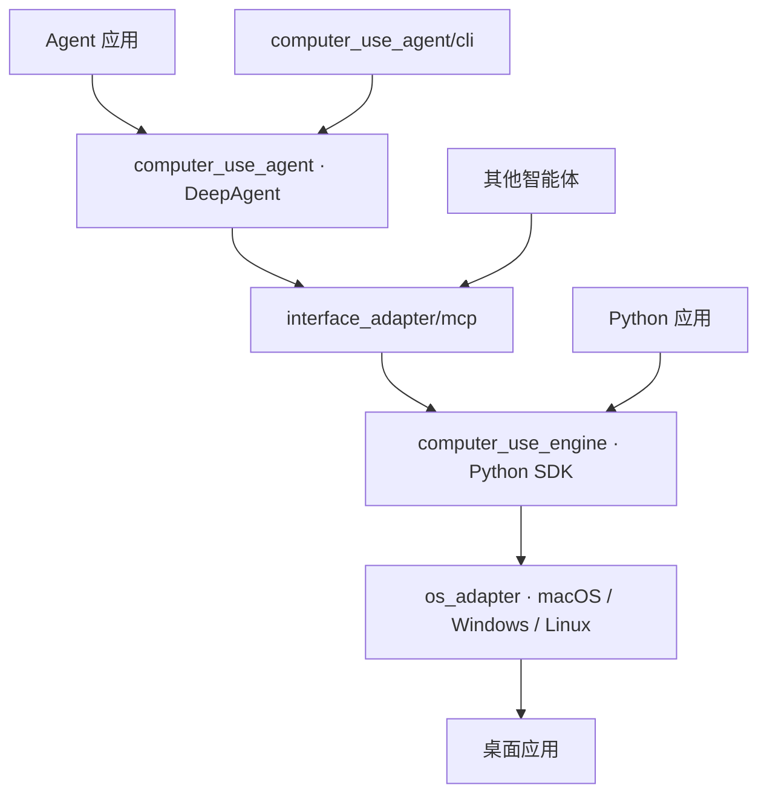

<div align="center">

# Computer Use

**openJiuwen 的计算机操作引擎与智能体：让智能体像人一样读屏幕、点控件、填表单**

[English](README.md) | 简体中文

<a href="LICENSE"></a>


</div>

## 简介

Computer Use 是 openJiuwen 智能体系统服务层（Agent System Service）中的桌面操作组件。它读取桌面应用的无障碍树与截图，通过鼠标键盘操作控件，并返回操作回执。当前支持 macOS、Windows、Linux。

开发者有两种形式可以接入使用：

**方法 1：接入 computer_use 引擎。** 通过 MCP 连接智能体，或直接调用 Python SDK。MCP 工具 `computer_use(title, code)` 提供 `Computer → App / Window → Element` 接口，模型编写 Python 完成操作，变量跨调用保留。智能体结合无障碍树和截图定位控件，并读取界面验证操作结果。

**方法 2：接入 Computer Use DeepAgent。** 使用基于 openJiuwen DeepAgent 组装的电脑操作智能体，通过标准 `invoke()`、`stream()` 和 `Runner` 接口集成到应用中。应用向智能体传入自然语言任务，由智能体观察桌面、执行操作并核对结果。

## 快速开始

### 一句话接入现有 Agent

将对应文案发送给能修改项目代码、执行命令的编程 Agent：

**接入 DeepAgent：**

```text
请阅读 https://gitcode.com/openJiuwen/computer-use 的 README，将 Computer Use DeepAgent 接入当前项目，按文档安装 Agent 依赖并准备本机后端，复用项目的模型配置，通过 create_agent 和标准 invoke/stream 接口调用（已有 openJiuwen DeepAgent 则接入 ComputerUseToolkit），最后用“列出正在运行的应用”验证接入。
```

**通过 MCP 接入：**

```text
请阅读 https://gitcode.com/openJiuwen/computer-use 的 README，在本机安装并构建 Computer Use，按文档将 computer-use-mcp 接入你当前的 MCP 工具配置，检查桌面访问权限，并调用 computer_use 列出正在运行的应用以验证接入。
```

### 安装与准备宿主

安装 Python 3.12 或更高版本及 `uv`，然后克隆仓库并安装依赖：

```bash
git clone https://gitcode.com/openJiuwen/computer-use.git
cd computer-use
uv sync
```

在需要操作桌面的目标电脑上准备原生依赖：

| 平台 | 环境要求 |
| --- | --- |
| macOS | macOS 14 或更高版本、包含 Swift 6 的 Xcode 工具链，以及辅助功能和屏幕录制权限。 |
| Windows | Windows x64、.NET Framework 4.8 及其 C# 编译器；窗口截图需要 Windows 10 1903 或更高版本。 |
| Linux | 包含 AT-SPI 和 PyGObject 的图形桌面会话；截图和鼠标输入使用 X11。 |

Debian 或 Ubuntu 需要先安装 Linux 系统依赖：

```bash
sudo apt install python3-gi python3-venv gir1.2-atspi-2.0 libx11-6 libxkbcommon0
```

构建或准备原生后端，并检查桌面访问条件：

```bash
uv run computer-use-build
uv run computer-use-permissions
```

macOS 可运行 `uv run computer-use-permissions --request` 请求缺失权限，在**系统设置 → 隐私与安全**中批准后重新检查。请使用与启动 MCP 相同的终端或宿主连接执行这些命令。

### 方法 1：接入引擎

#### MCP

```bash
uv run computer-use-mcp --desktop exclusive
```

服务使用 stdio 通信。对于采用 `mcpServers` 配置的客户端，可使用：

```json
{
  "mcpServers": {
    "computer-use": {
      "command": "uv",
      "args": [
        "--directory", "/absolute/path/to/computer-use",
        "run", "computer-use-mcp", "--desktop", "exclusive"
      ]
    }
  }
}
```

将仓库路径替换为目标电脑上的绝对路径。`exclusive` 允许必要的前台准备和整桌面输入；`shared` 将输入限制在选定的 App 或 Window 范围内。不显式指定时，读取 `COMPUTER_USE_DESKTOP`，默认值为 `shared`。

`computer_use` 工具中已提供 `computer`、`print()` 和 `print_image()`。可以先查询应用引用：

```python
print(await computer.list_apps())
```

通过 `computer.app(id)` 选择应用，用 `await app.read(view="both")` 观察界面，再用 `await app.element(name_or_path)` 定位控件后执行操作。

#### Python SDK

将以下示例保存为 `list_apps.py`，通过 `uv run python list_apps.py` 运行：

```python
import asyncio

from computer_use import Computer


async def main():
    computer = Computer()
    for app in await computer.list_apps():
        print(app.id, app.display_name, app.is_running)


asyncio.run(main())
```

### 方法 2：接入 DeepAgent

使用 Python 3.12 或 3.13 安装 Agent 依赖：

```bash
uv sync --extra agent
```

通过 openJiuwen 的 `ModelClientConfig`、`ModelRequestConfig` 配置支持工具调用和图片输入的模型。以下示例从 `MODEL_PROVIDER`、`API_BASE`、`API_KEY`、`MODEL_NAME` 环境变量读取服务提供方、地址、密钥和模型名称。

`ComputerUseAgent` 继承 DeepAgent 的标准 `invoke()`、`stream()` 接口，也可交给 `Runner` 执行。模型使用 openJiuwen 原生配置构建，后续消息复用 `conversation_id`：

```python
import asyncio
import os

from openjiuwen.core.foundation.llm import Model, ModelClientConfig, ModelRequestConfig

from computer_use_agent import create_agent


async def main():
    model = Model(
        model_client_config=ModelClientConfig(
            client_provider=os.getenv("MODEL_PROVIDER", "OpenAI"),
            api_base=os.environ["API_BASE"],
            api_key=os.environ["API_KEY"],
        ),
        model_config=ModelRequestConfig(model=os.environ["MODEL_NAME"]),
    )
    async with create_agent(model) as agent:
        conversation_id = "desktop-conversation"
        print(await agent.invoke({"query": "列出正在运行的应用", "conversation_id": conversation_id}))
        async for chunk in agent.stream({"query": "查看计算器窗口", "conversation_id": conversation_id}):
            print(chunk)


asyncio.run(main())
```

Agent 默认以 `exclusive` 模式操作本机桌面。可传入 `config=AgentConfig(desktop="shared")` 选择共享模式，或通过 `AgentConfig.mcp` 配置 `McpConfig` 连接其他 MCP 宿主。异步上下文在对话结束时清理电脑操作会话。

已有 openJiuwen DeepAgent 应用也可以通过 `ComputerUseToolkit` 接入标准工具集合：

```python
from openjiuwen.harness import create_deep_agent

from computer_use_agent import ComputerUseToolkit


async def run(model):
    async with ComputerUseToolkit() as desktop:
        agent = create_deep_agent(
            model,
            tools=desktop.tools,
            system_prompt=desktop.system_prompt,
            parallel_tool_calls=False,
            enable_tool_resilience_rail=False,
            enable_sys_operation=False,
            enable_read_image_multimodal=True,
        )
        return await agent.invoke({"query": "列出正在运行的应用"})
```

#### 直接使用 CLI

同一个 Agent 也可以通过 CLI 直接运行。首次执行 `uv run --extra agent computer-use-agent --init-config`，在生成的 `~/.computer-use/agent/config.json` 中填写 `model`、`provider`、`api_base`、`api_key`，随后进入对话或执行单次任务：

```bash
uv run --extra agent computer-use-agent
uv run --extra agent computer-use-agent "打开预定会议表单，停在提交前"
```

命令行选项可通过 `uv run --extra agent computer-use-agent --help` 查看。

### 可选：读取视线确认的窗口（macOS）

已有的本地视线选择服务可以把用户确认的窗口交给 Agent。设置 `AgentConfig(gaze_connection_file="/absolute/path/to/connection.json")`，或在 CLI 的 JSON 配置中加入 `gaze_connection_file`，即可启用 `read_gaze_target(expected_selection_id?)`。语音请求必须传入对应的选择 ID。不配置时，默认工具和行为保持不变。

视线服务及完成校准的摄像头面板需要事先在同一台 Mac 上运行；本项目不会自动安装或启动它们。连接文件格式为 `{"url":"http://127.0.0.1:PORT","token":"SESSION_TOKEN"}`，请勿公开令牌。该功能只支持默认的本机 macOS MCP 连接，不支持自定义或远程 MCP。

请运行 `uv run computer-use-build` 重建驱动，并同时更新 Python 包和驱动。新增的可选 `nativeIdentity` 字段携带进程 ID 和原生窗口 ID；`computer_use.integrations.macos.app_for_window` 通过现有发现流程把它们映射为 App 引用，不按标题或列表顺序猜测。缺少或存在多个匹配时直接失败。旧驱动仍可配合新包执行普通操作，但无法提供此映射。

工具在读取前后验证同一个选择，结束后释放占用；选择变化时不向模型返回快照。读取范围遵循现有 App 语义，包含已确认的附属对话框。该工具只负责读取，不构成操作授权，也不限制另一个 `computer_use` 工具。本地诊断回调可能收到随后被丢弃的中间捕获结果。若占用或释放结果不确定，请等待服务的 120 秒租约过期，再重建 toolkit 并重新确认。

无需调用模型即可验证一次已确认的选择：

```bash
uv run --extra agent python tests/manual/read_gaze_target.py /absolute/path/to/connection.json /tmp/gaze-read
```

脚本将观察结果和图片保存在本地。详见[服务接口与限制](computer_use_agent/GAZE.md)。摄像头准确性与校准仍需真人实测。

## 架构简介

项目由接入层、Agent 组装层、引擎层和操作系统适配层组成。应用可以集成 DeepAgent，也可以通过 MCP 接入其他智能体，或直接调用 SDK：



DeepAgent 负责模型调用、对话上下文与工具循环；引擎维护 `Computer → App / Window → Element` 接口、目标身份、观察结果及操作选路；操作系统适配器负责解析原生对象、准备输入接收者并派发操作。智能体收到 `dispatched` 或 `verified` 回执后，通过再次读取界面确认任务效果。

## 功能特性

- **DeepAgent 接入**：支持 openJiuwen 标准调用、流式输出和 Runner 接入，电脑操作工具可复用于已有 DeepAgent 应用。
- **单工具代码执行**：模型写 Python，变量跨调用保留，一次调用完成多步工作流。
- **无障碍树优先**：元素按十进制 ref 编号，支持 `element(path)` 路径查询、文本分页读取、菜单读取。
- **可核验回执**：每个动作返回 `dispatched` / `verified`，失败结构化为 `code / effect / next`。
- **共享与独占两种桌面模式**：默认不抢前台，对后台窗口定向输入；可按需启用前台辅助。
- **跨平台原生驱动**：macOS、Windows、Linux 各一套，协议一致。
- **可观测**：每次执行写入 `~/.computer-use/logs` 的 JSONL 日志，含代码、观测与回执。

## 项目结构

四层代码与配套文件的目录组织如下：

```
computer-use/
├── interface_adapter/       # 接入层：MCP 接入
│   └── mcp/                 # stdio MCP 宿主与持久化 Python 执行环境
├── computer_use_agent/      # Agent 组装层：DeepAgent、上下文与工具接入
│   └── cli/                 # 直接对话与配置
├── computer_use_engine/     # 引擎层：公共 SDK、观察与操作管线
├── os_adapter/              # 操作系统适配层：原生后端与共用资源
│   ├── macos/
│   ├── windows/
│   └── linux/
├── scripts/                 # 原生构建、权限检查与资源生成
├── tests/                   # 单元测试
├── pyproject.toml           # 包元数据、依赖与命令行入口
├── LICENSE                  # Apache License 2.0
└── OPEN_SOURCE_SOFTWARE_NOTICE.md
```

## 完整文档

- [DeepAgent 接入](computer_use_agent/agent.py)：Agent 构建、标准调用与会话生命周期。
- [DeepAgent 工具](computer_use_agent/toolkit.py)：已有 openJiuwen 应用的工具接入。
- [SDK 接口参考](computer_use_engine/__init__.pyi)：`Computer`、`App`、`Window`、`Element` 的公开接口与参数类型。
- [MCP 服务入口](interface_adapter/mcp/server.py)：工具定义、执行说明与桌面模式参数。
- [原生环境准备命令](scripts/native.py)：各平台构建、权限检查与 Linux 会话配置。
- [直接对话](computer_use_agent/cli/main.py)：命令行选项与交互命令。

## 参与贡献

欢迎通过 Issue 与 Pull Request 参与。提交前请确保：

1. 原生驱动改动附带可在本机编译通过的说明；
2. 引擎层改动不引入对任何智能体框架的依赖；
3. 新增行为有对应的单元测试或可复现的探针脚本。

## 开源许可证

本项目基于 [Apache License 2.0](LICENSE) 开源。

本产品仅作为流程编排工具，不包含 AI 模型能力；用户在连接 AI 模型用于特定业务场景时，需自行承担欧盟 AI 法案等相关合规义务。
